





<a href="https://github.com/hickytani/cineverse"></a>
<a href="https://github.com/hickytani/mythverse"></a>
<a href="https://github.com/hickytani/verdant-atelier"></a>
<a href="https://github.com/hickytani/TravelOs"></a>
<a href="https://github.com/hickytani/vellum-web"></a>
<a href="https://github.com/hickytani/threat"></a>


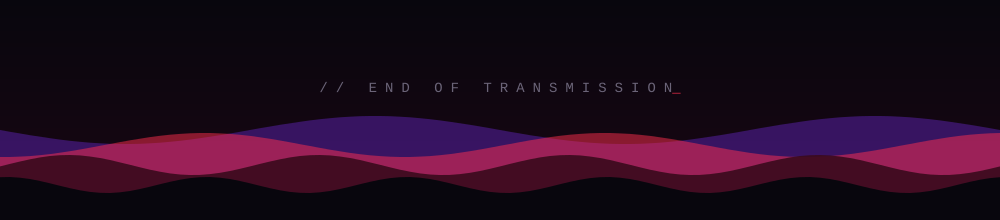

