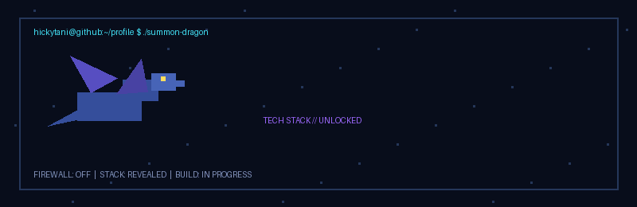
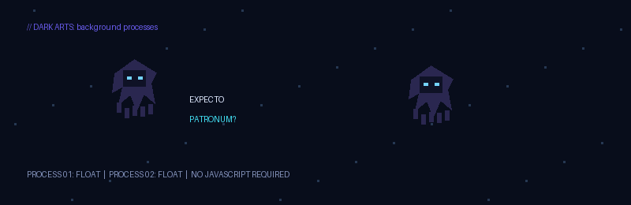
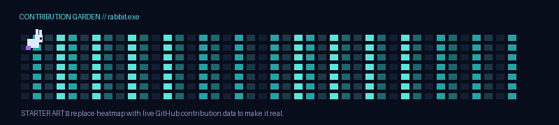

<div align="center">





# `Prasun aka hickytani`

**this side.**

building stuff · trying things · learning how things work

</div>

---

```bash
$ whoami
Prasun aka hickytani

$ interests
full-stack / backend / AI APIs / developer tools / systems

$ current_mode
building things and figuring them out as I go
```

## `// toolkit`

| Language | Build | Backend & data |
|:--|:--|:--|
| Java · C++ · Python | JavaScript · TypeScript · React · Next.js | FastAPI · Node.js · PostgreSQL · Docker |
| AI APIs · RAG · agents | Git · Linux · REST APIs | systems · developer tooling |

## `// contribution garden`

<div align="center">



</div>

> The rabbit animation is currently a visual starter, not connected to your actual contribution data yet. To make it track your real GitHub graph, add a generator workflow that fetches your contribution calendar and redraws the heatmap.

---

<div align="center">

<sub>cyan → indigo → violet · built in pixels, powered by curiosity</sub>

</div>
